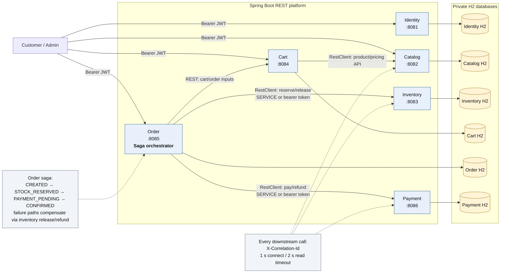

# Platform Architecture Diagram

The databases are private to their owning service. No service reads another
service's database; all cross-service integration uses REST DTOs. Docker,
Kubernetes, Kafka, RabbitMQ, Redis, and external databases are not runtime
dependencies.
